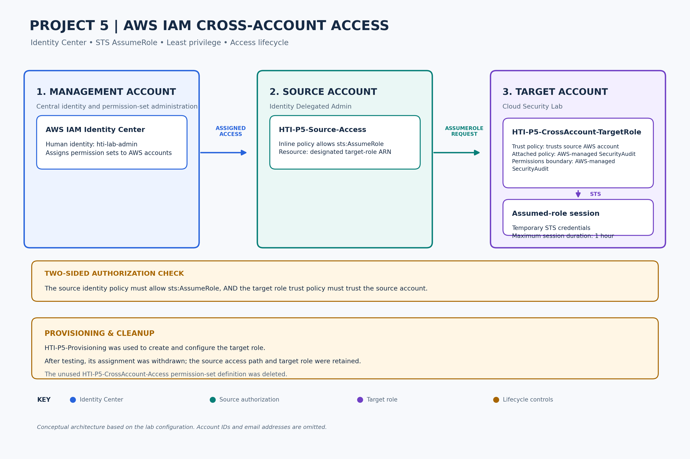

# Project 5 — AWS IAM Cross-Account Access & Least Privilege

**Author:** Taiwo H Ibrahim  
**Platform:** Amazon Web Services (AWS)  
**Services:** AWS IAM, IAM Identity Center, AWS Security Token Service (STS)  
**Focus:** Cross-account access, identity management, least privilege and access lifecycle management.

---

## 1. Project Overview

This project demonstrates the design, implementation and validation of restricted AWS identity and access controls across two related scenarios:

1. **Core:** controlled cross-account access using AWS IAM Identity Center, IAM and STS.
2. **Extension:** external Google identity federation using AWS OIDC and STS `AssumeRoleWithWebIdentity`.

The core objective was to allow an authorized identity in a source AWS account to assume a specifically designated IAM role in a separate target account, without granting unnecessary permissions.

The extension builds on the same least-privilege principles by allowing an external Google identity to obtain temporary AWS credentials through a dedicated federation role, without reusing the core cross-account role.

The implementation uses:

- AWS IAM Identity Center for centralized human identity and access management.
- Permission sets to assign controlled access to AWS accounts.
- An identity-based policy restricting `sts:AssumeRole` to a specific target role.
- An IAM role trust policy defining the trusted source account.
- AWS STS to establish temporary credentials.
- AWS-managed `SecurityAudit` permissions for read-oriented security auditing.
- A permissions boundary to limit the core target role's maximum permissions.
- An AWS OIDC provider and dedicated IAM role for external Google identity federation.
- Scoped S3 permissions to validate allowed and denied actions for the federated identity.
- CloudTrail validation of the external federation event.

The project also demonstrates administrative access withdrawal after provisioning and validation.

## 2. Business Problem

In a multi-account AWS environment, administrators and security analysts may need to inspect resources in accounts other than the one through which they initially authenticate.

A related challenge occurs when an organization needs to provide controlled access to an external identity without creating a permanent IAM user or extending the permissions of an existing internal role.

Granting permanent administrative permissions or unnecessary IAM users increases the risk of excessive access and credential compromise.

The challenge was therefore to establish controlled access mechanisms for both an internal cross-account identity and an external federated identity, while limiting scope and permissions.

## 3. Security Objectives

### Core cross-account scenario

1. Implement controlled access between two AWS accounts.
2. Use IAM Identity Center to manage human access.
3. Restrict source-side authorization to one designated target IAM role.
4. Configure a cross-account trust relationship.
5. Apply read-oriented auditing permissions to the target role.
6. Enforce a permissions boundary.
7. Validate successful and denied access scenarios.
8. Withdraw unnecessary provisioning access after deployment.

### External federation extension

9. Federate an external Google identity using OIDC.
10. Use a dedicated IAM role for `sts:AssumeRoleWithWebIdentity`.
11. Restrict the federated role's permissions to specific S3 resources/actions.
12. Validate allowed and denied S3 operations.
13. Validate the federation event through CloudTrail.

## 4. AWS Account Architecture

The implementation uses three account responsibilities:

| Account | Responsibility |
|---|---|
| Management account | IAM Identity Center administration |
| Identity Delegated Admin | Source account |
| Cloud Security Lab | Target account |

The External Google OIDC Federation extension operates in the Cloud Security Lab target account using a dedicated IAM role.

Account identifiers and other sensitive information are intentionally excluded from this public overview.

### Identity and access components

**Human identity:** `hti-lab-admin`

**Source permission set:** `HTI-P5-Source-Access`

**Core target IAM role:** `HTI-P5-CrossAccount-TargetRole`

**Core target permissions policy:** AWS-managed `SecurityAudit`

**Core target permissions boundary:** AWS-managed `SecurityAudit`

**External federation role:** `HTI-P5-ExternalGoogleFederationRole`

**External federation access:** Scoped S3 read permissions

**Maximum core target-role session duration:** One hour.

## 5. Architecture and Access Flow

### 5.1 Core cross-account flow

1. The administrator authenticates through AWS IAM Identity Center.
2. IAM Identity Center provides access to the Identity Delegated Admin source account through `HTI-P5-Source-Access`.
3. The source permission set authorizes `sts:AssumeRole` only for the designated target role ARN.
4. AWS STS evaluates the request against the source-side permissions and the target role's trust policy.
5. If authorized, STS provides temporary credentials for the target role.
6. The administrator accesses Cloud Security Lab using `HTI-P5-CrossAccount-TargetRole`.
7. The target role's effective permissions are constrained by its attached permissions policy, permissions boundary and other applicable controls.

### 5.2 External Google OIDC federation flow

1. An external Google identity authenticates through the Google OAuth/OIDC flow.
2. The resulting OIDC identity token is presented to AWS STS.
3. AWS STS evaluates the token against the trust policy of `HTI-P5-ExternalGoogleFederationRole`.
4. If the identity, audience and trust conditions match, STS issues temporary credentials through `AssumeRoleWithWebIdentity`.
5. The federated identity accesses only the AWS resources permitted by the dedicated role's scoped policies.
6. Allowed and denied S3 operations are validated, and the federation event is observable through CloudTrail.

**Security distinction:**

- The core source identity policy controls which target role can be requested.
- The core target trust policy controls which AWS account principal is trusted.
- The external federation trust policy controls which external OIDC identity can request the dedicated federation role.
- Attached permissions policies define what each assumed role can do.
- Permissions boundaries and resource scoping limit effective access.

### Architecture diagrams

[View the scalable SVG version](architecture/project-5-aws-iam-cross-account-architecture-final.svg).

External federation architecture:

[View the scalable SVG version](architecture/P5-external-identity-federation-architecture.svg).

## 6. Implementation

### 6.1 IAM Identity Center

Created and configured the human identity and permission sets required for the core exercise.

The source permission set, `HTI-P5-Source-Access`, contains a restricted inline policy authorizing `sts:AssumeRole` against the specific target role ARN.

### 6.2 Source-side authorization

The source policy follows the principle of least privilege by limiting role assumption to one designated resource.

The policy does not grant general IAM read access or administrative permissions in the source account.

### 6.3 Core target IAM role

Created `HTI-P5-CrossAccount-TargetRole` in Cloud Security Lab.

Its trust policy trusts the Identity Delegated Admin source account.

The target role has:

- AWS-managed `SecurityAudit` attached as its permissions policy.
- AWS-managed `SecurityAudit` configured as its permissions boundary.
- A maximum session duration of one hour.

### 6.4 Provisioning controls

A separate permission set, `HTI-P5-Provisioning`, was originally created as a temporary administrative permission set for configuring the core target role.

During the External Google OIDC Federation extension, the same provisioning permission set was reused and augmented with additional narrowly scoped permissions required to configure the dedicated federation role and associated policies.

This reuse did not make `HTI-P5-Provisioning` part of the runtime external access path. The external identity instead used the dedicated `HTI-P5-ExternalGoogleFederationRole`.

After provisioning and testing activities were completed, the `HTI-P5-Provisioning` assignment to `hti-lab-admin` in Cloud Security Lab was withdrawn. The permission-set definition was retained.

The unused `HTI-P5-CrossAccount-Access` permission-set definition was retired.

### 6.5 External Google OIDC Federation

The extension uses a dedicated AWS OIDC federation role rather than modifying the existing cross-account target role.

The trust relationship is restricted to the intended Google OIDC identity and OAuth client audience.

The role is assigned scoped S3 permissions for the extension's validation tests.

The federation workflow was validated through:

- Successful `AssumeRoleWithWebIdentity`.
- Successful STS caller identity confirmation.
- Successful S3 listing within the permitted prefix.
- Successful `GetObject` access to the permitted test object.
- Denied `PutObject` access outside the permitted write scope.
- Denied `DeleteObject` access.
- CloudTrail evidence showing the `AssumeRoleWithWebIdentity` event.

## 7. Testing and Validation

### 7.1 Core cross-account testing

| Test | Result |
|---|---|
| Source identity access through Identity Center | Successful |
| Source identity attempts `iam:ListRoles` | Access denied as expected |
| Cross-account target-role assumption | Successful |
| Target IAM Roles page access | Successful |
| IAM Policy Simulator — `iam:ListRoles` | Allowed |
| IAM Policy Simulator — `iam:CreateRole` | Denied by permissions boundary |
| Target role `SecurityAudit` attachment | Verified |
| Target role permissions boundary | Verified |
| Cross-account access after provisioning assignment withdrawal | Successful |

**Testing note:** Policy Simulator results are identified separately from live AWS console tests. Simulator outcomes are not presented as live API execution results.

### 7.2 External Google OIDC federation testing

| Test | Result |
|---|---|
| Google OIDC identity token generated | Successful |
| `AssumeRoleWithWebIdentity` | Successful |
| Federated STS caller identity confirmed | Successful |
| S3 prefix listing within permitted scope | Allowed |
| `GetObject` on permitted test object | Allowed |
| `PutObject` test | Access denied |
| `DeleteObject` test | Access denied |
| CloudTrail federation event | Verified |

## 8. Access Lifecycle Management

Following successful provisioning and testing:

- The `HTI-P5-Provisioning` assignment was removed from `hti-lab-admin`.
- Its permission-set definition was retained for controlled future provisioning.
- The unused `HTI-P5-CrossAccount-Access` permission-set definition was deleted.
- `HTI-P5-Source-Access` was retained.
- `HTI-Lab-Security-Audit` was retained.
- The core target IAM role and its security configuration remained intact.
- The external federation role and scoped policies remained as the runtime configuration for the extension.

The core cross-account role assumption was successfully tested after the provisioning assignment was withdrawn.

## 9. Security Findings and Limitations

### Findings

- Source-side role assumption was restricted to a specific target role ARN.
- The core target role used a separate trust policy to establish the cross-account trust relationship.
- The core target role had an auditing-oriented permissions policy and a permissions boundary.
- The external federation role used a separate OIDC trust relationship and scoped S3 permissions.
- External federation produced temporary STS credentials rather than permanent IAM user credentials.
- Allowed and denied S3 operations demonstrated the effect of scoped authorization.
- CloudTrail provided evidence of the external `AssumeRoleWithWebIdentity` event.
- Provisioning access was withdrawn after implementation.
- Core cross-account access remained functional after cleanup.

### Observed limitation

During core testing, the target role received an `AccessDenied` response for the `access-analyzer:ListPolicyGenerations` operation.

This permission limitation was observed during the lab and remained unresolved. It did not prevent the successful core cross-account role-assumption workflow.

### Scope limitation

This was a practical cloud security lab implementation, not a production AWS security assessment. The findings and conclusions are limited to the configurations and tests performed.

## 10. Project Outcome

The project successfully demonstrated two related but distinct AWS identity patterns:

- Controlled cross-account access using IAM Identity Center, IAM and STS.
- External Google OIDC federation using a dedicated IAM role and scoped AWS permissions.

Together, the exercises demonstrate practical IAM least privilege, explicit trust relationships, temporary credentials, scoped authorization, access lifecycle management, external identity federation, and security validation using both access-denial testing and CloudTrail evidence.

## 11. Repository Contents

Project documentation and supporting evidence are organized into:

- `architecture/` — architecture diagrams and design explanation.
- `iam/` — relevant IAM policy documents and configuration notes.
- `evidence/` — core and external-federation evidence, each organized in a dedicated subfolder with supporting README documentation.
- `testing/` — test plan and validation results.
- `findings/` — security review and observations.
- `docs/` — operational runbook and supporting documentation.

---

**Author:** Taiwo H Ibrahim  
**GitHub:** [taiwo-h-ibrahim](https://github.com/taiwo-h-ibrahim)