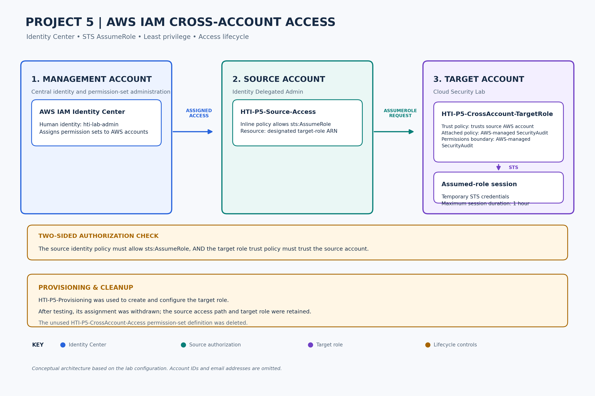

# Project 5 Architecture — AWS IAM Cross-Account Access & External Identity Federation

## Architecture Overview

This project demonstrates two related AWS identity and access patterns:

1. **Core — Cross-account access:** controlled access between two AWS accounts using AWS IAM Identity Center, IAM permission sets, AWS STS, and a dedicated target IAM role.
2. **Extension — External identity federation:** controlled access for an external Google identity using AWS OIDC, STS `AssumeRoleWithWebIdentity`, a dedicated federation role, and scoped S3 permissions.

Both components apply least-privilege principles by separating authentication, trust, authorization, and runtime permissions.

## AWS Accounts

| Account | Purpose |
|---|---|
| Identity Delegated Admin | Source account used to initiate core cross-account access |
| Cloud Security Lab | Target account containing the core target role and the external federation role |

Numeric AWS account identifiers are intentionally redacted from this public repository.

The AWS IAM Identity Center administration is managed through a separate management account.

## Part A — Core Cross-Account Architecture

### Access Flow

1. The administrator signs in through the AWS IAM Identity Center access portal using the `hti-lab-admin` user.
2. The `HTI-P5-Source-Access` permission set provides narrowly scoped permission to call `sts:AssumeRole` on the designated target role.
3. AWS STS evaluates the source identity's permission and the target role's trust policy.
4. The target account's `HTI-P5-CrossAccount-TargetRole` is assumed.
5. The assumed role provides temporary credentials and access governed by its attached `SecurityAudit` policy and permissions boundary.

### Security Controls

- **Restricted source permissions:** The source permission set allows assumption of the designated target role rather than unrestricted IAM administration.
- **Cross-account trust:** The target role trusts the source AWS account.
- **Role-based access:** Access to the target account is provided through a dedicated IAM role.
- **Audit-oriented permissions:** The target role uses the AWS-managed `SecurityAudit` policy.
- **Permissions boundary:** The target role has a `SecurityAudit` permissions boundary to limit its maximum permissions.
- **Temporary credentials:** Role assumption uses AWS STS temporary credentials, with a maximum session duration of one hour.
- **Provisioning separation:** The temporary provisioning permission-set assignment was withdrawn after the target role was configured.

### Core Architecture Diagram

[View the scalable SVG version](project-5-aws-iam-cross-account-architecture-final.svg).

---

## Part B — External Google OIDC Federation Architecture

### Access Flow

1. An external Google identity authenticates through the Google OAuth/OIDC flow.
2. The resulting OIDC identity token is presented to AWS STS.
3. AWS STS evaluates the token against the trust policy of `HTI-P5-ExternalGoogleFederationRole`.
4. If the identity, audience, and trust conditions match, STS issues temporary credentials through `AssumeRoleWithWebIdentity`.
5. The federated identity accesses only the AWS resources permitted by the dedicated role's scoped policies.
6. S3 read, write, and delete operations are tested to demonstrate the effective authorization boundary.
7. CloudTrail records the federation event for audit and investigation.

### External Federation Security Controls

- **Dedicated federation role:** The external identity does not reuse the core `HTI-P5-CrossAccount-TargetRole`.
- **OIDC trust:** The role trust policy is restricted to the intended Google OIDC identity and OAuth client audience.
- **Temporary credentials:** AWS STS provides temporary credentials rather than a permanent IAM user.
- **Scoped S3 access:** The federated role is limited to the S3 resources and actions required for the lab.
- **Explicit denial validation:** Write and delete operations are tested and expected to fail.
- **CloudTrail visibility:** The `AssumeRoleWithWebIdentity` event provides an audit trail for the federation activity.
- **Provisioning separation:** `HTI-P5-Provisioning` was used only during configuration and was not part of the runtime external identity access path.

### External Federation Architecture Diagram

[View the scalable SVG version](P5-external-identity-federation-architecture.svg).

### External Federation Validation

| Operation | Result |
|---|---|
| `AssumeRoleWithWebIdentity` | Allowed |
| Federated STS caller identity | Confirmed |
| S3 prefix listing within permitted scope | Allowed |
| `GetObject` on permitted test object | Allowed |
| `PutObject` | Denied |
| `DeleteObject` | Denied |
| CloudTrail `AssumeRoleWithWebIdentity` event | Verified |

## Architecture Relationship

The two components demonstrate different trust and access models:

| Component | Authentication / Trust | Runtime Access |
|---|---|---|
| Core cross-account | AWS IAM Identity Center + AWS account trust | `HTI-P5-CrossAccount-TargetRole` |
| External federation | Google OIDC identity + OIDC trust policy | `HTI-P5-ExternalGoogleFederationRole` |

The core workflow uses an AWS account principal to establish cross-account role access. The extension instead uses an external OIDC identity and `AssumeRoleWithWebIdentity` to obtain temporary AWS credentials.

The external federation role is deliberately separate from the core cross-account role so that the external identity cannot inherit the core role's trust relationship or permissions.

## Design Principle

The central security principle is **least privilege through separation of trust and authorization**:

- Authentication establishes who the identity is.
- The trust policy determines whether that identity may assume the role.
- The attached permissions policies determine what the assumed role can do.
- Resource-level scoping and explicit denied-operation testing demonstrate the effective authorization boundary.
- Temporary provisioning access is separated from runtime access.

Together, the two architectures demonstrate practical AWS IAM access control across internal and external identity scenarios.
